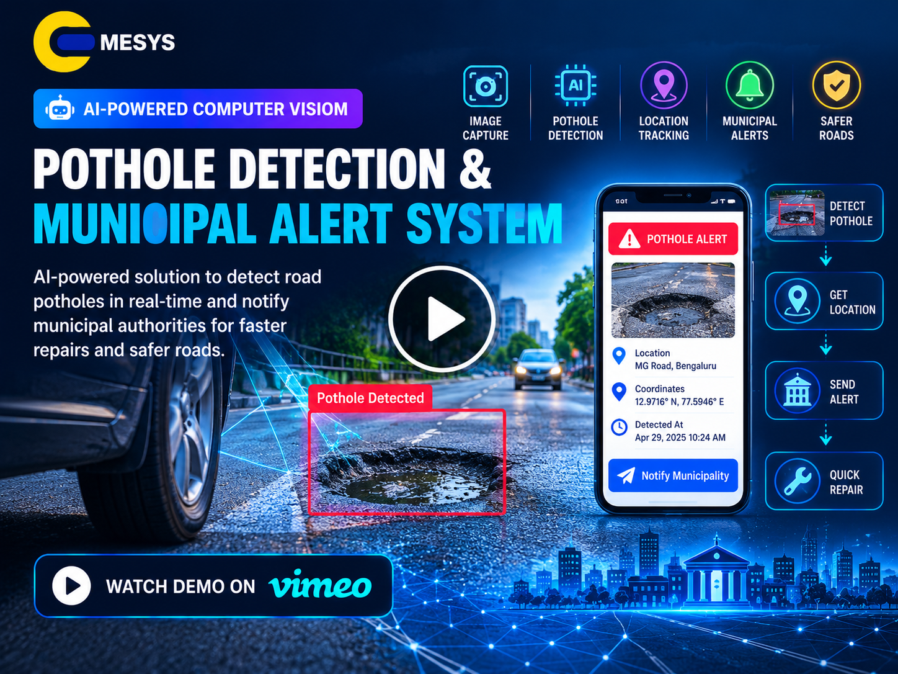

# 🕳️ Pothole Detection & Municipal Alert System

> **An AI-powered computer vision and geospatial platform for detecting, locating, categorizing, and reporting road potholes to municipal authorities.**

<p align="center">


</p>

---

## 📑 Table of Contents

- [Project Overview](#-project-overview)
- [Problem Statement](#-problem-statement)
- [Our Solution](#-our-solution)
- [Key Features](#-key-features)
- [System Workflow](#-system-workflow)
- [Detection Pipeline](#-detection-pipeline)
- [Severity Classification](#-severity-classification)
- [Geospatial Mapping](#-geospatial-mapping)
- [Municipal Alert System](#-municipal-alert-system)
- [Project Phases](#-project-phases)
- [Technology Stack](#-technology-stack)
- [Project Architecture](#-project-architecture)
- [Deployment Architecture](#-deployment-architecture)
- [Expected Deliverables](#-expected-deliverables)
- [Screenshots](#-screenshots)
- [Project Demo](#-project-demo)
- [Future Enhancements](#-future-enhancements)
- [License](#-license)

---

## 🚧 Project Overview

Road surface degradation, especially potholes, creates significant risks for road users, increases vehicle maintenance costs, and contributes to infrastructure damage.

The **Pothole Detection & Municipal Alert System** is designed as an automated computer vision and IoT-enabled solution that detects potholes from **dashcam footage or smartphone video feeds**, estimates their severity, extracts their geographic location, and generates actionable reports for municipal/public works teams.

The proposed platform combines:

- **YOLOv8-based pothole detection**
- **Real-time video analysis**
- **GPS and timestamp extraction**
- **Severity classification**
- **Geospatial mapping**
- **Centralized spatial data storage**
- **Automated municipal alerts**
- **GIS-based management dashboard**

The system is intended to help public works departments prioritize road repairs using **severity scores and geographic clustering**. fileciteturn2file0L37-L46

---

## ⚠️ Problem Statement

Traditional pothole reporting can depend heavily on manual inspection and citizen complaints. This can make it difficult to continuously monitor large road networks and accurately identify the exact location and severity of road defects.

The project addresses this challenge by creating an automated pipeline that can:

1. Analyze road footage captured from a moving vehicle.
2. Detect potholes using an object detection model.
3. Categorize detected potholes by severity.
4. Associate detections with latitude, longitude, and timestamps.
5. Store detections in a centralized database.
6. Display pothole locations on a GIS dashboard.
7. Generate municipal service tickets and notifications.

The source project specifically defines real-time detection, geo-tagging, automated municipal alerts, and an interactive GIS management dashboard as core objectives. fileciteturn2file0L42-L46

---

## 💡 Our Solution

The platform transforms ordinary road video into structured infrastructure-maintenance information.

```text
┌──────────────────────────────┐
│ Dashcam / Smartphone Video   │
│ + GPS / Timestamp Metadata   │
└──────────────┬───────────────┘
               │
               ▼
┌──────────────────────────────┐
│ Video Frame Processing       │
│ OpenCV                       │
└──────────────┬───────────────┘
               │
               ▼
┌──────────────────────────────┐
│ YOLOv8 Pothole Detection     │
│ Bounding Box + Confidence    │
└──────────────┬───────────────┘
               │
               ▼
┌──────────────────────────────┐
│ Severity Classification      │
│ Minor / Moderate / Severe    │
└──────────────┬───────────────┘
               │
               ▼
┌──────────────────────────────┐
│ GPS / Geospatial Processing  │
│ Latitude + Longitude         │
└──────────────┬───────────────┘
               │
               ▼
┌──────────────────────────────┐
│ Spatial Database             │
│ SQLite / PostgreSQL          │
└──────────────┬───────────────┘
               │
               ▼
┌──────────────────────────────┐
│ GIS / Streamlit Dashboard    │
│ Maps + Reports + Statistics  │
└──────────────┬───────────────┘
               │
               ▼
┌──────────────────────────────┐
│ Municipal Alert / Ticketing  │
│ Email / Webhook / SMS        │
└──────────────────────────────┘
```

---

## ✨ Key Features

### 🎯 1. Real-Time Pothole Detection

The system uses **YOLOv8** to detect potholes from moving-vehicle video feeds.

**Capabilities:**

- Frame-by-frame video processing
- Pothole localization
- Bounding-box detection
- Detection confidence
- Real-time inference support
- Localized road-defect datasets

The project specification identifies YOLOv8 as the primary real-time object detection approach. fileciteturn2file0L47-L50

---

### 📊 2. Severity Classification

Detected potholes are categorized into three severity levels:

| Severity | Description | Municipal Priority |
|---|---|---|
| 🟢 Minor | Smaller / lower-impact road defect | Normal |
| 🟡 Moderate | Noticeable road-surface degradation | High |
| 🔴 Severe | Major defect requiring urgent attention | Critical |

Severity is intended to be based on **depth and surface-area approximation**, supporting municipal repair prioritization. fileciteturn2file0L49-L50

> **Note:** The source specification does not provide fixed numerical thresholds for Minor, Moderate, or Severe classification. Those thresholds should be calibrated during model development and field validation.

---

### 📍 3. GPS Geo-Tagging

Each detected pothole can be associated with location metadata extracted from:

- Video frame metadata
- Mobile-device GPS streams
- Timestamp information

Example record:

```text
Pothole ID   : PH-0001
Latitude     : 20.xxxxxx
Longitude    : 85.xxxxxx
Timestamp    : YYYY-MM-DD HH:MM:SS
Severity     : Severe
Confidence   : 0.91
Status       : Reported
```

The project specification explicitly requires GPS coordinates and timestamp metadata to map potholes to precise geographic locations. fileciteturn2file0L42-L45

---

## 🔄 System Workflow

```text
        VIDEO / GPS INPUT
               │
               ▼
      ┌─────────────────┐
      │ Frame Extraction│
      └────────┬────────┘
               │
               ▼
      ┌─────────────────┐
      │ YOLOv8 Detection│
      └────────┬────────┘
               │
               ▼
      ┌─────────────────┐
      │ Severity Grading│
      └────────┬────────┘
               │
               ▼
      ┌─────────────────┐
      │ GPS Association │
      └────────┬────────┘
               │
               ▼
      ┌─────────────────┐
      │ Spatial Database│
      └────────┬────────┘
               │
          ┌────┴────┐
          ▼         ▼
      GIS MAP    ALERT ENGINE
          │         │
          └────┬────┘
               ▼
       MUNICIPAL ACTION
```

---

## 🧠 Detection Pipeline

### Step 1 — Video Acquisition

Input can come from:

- Dashcam footage
- Smartphone video
- Moving-vehicle camera feeds

The field-testing setup is expected to use a mobile phone or dashcam with GPS logging capability. fileciteturn2file0L83-L86

### Step 2 — Frame Processing

OpenCV is used as part of the computer-vision pipeline to process incoming video frames.

### Step 3 — Object Detection

YOLOv8 identifies potholes and returns:

```text
Class
Bounding Box
Confidence Score
Frame Number
Timestamp
```

### Step 4 — Severity Estimation

The detected road defect is assigned:

```text
Minor
Moderate
Severe
```

### Step 5 — Geospatial Association

The detection is linked with available GPS coordinates and timestamp metadata.

### Step 6 — Storage

The structured detection is stored in a spatially enabled data layer.

### Step 7 — Municipal Alert

Reports can be aggregated and sent to municipal authorities using:

- Email
- Webhooks
- SMS

This detection-to-alert flow is part of the defined geospatial integration and municipal dispatch design. fileciteturn2file0L51-L53

---

## 🗺️ Geospatial Mapping

The system converts individual pothole detections into actionable geographic information.

### Example GIS Data Model

| Field | Description |
|---|---|
| `pothole_id` | Unique detection/report ID |
| `latitude` | Pothole latitude |
| `longitude` | Pothole longitude |
| `timestamp` | Detection time |
| `severity` | Minor / Moderate / Severe |
| `confidence` | Model confidence |
| `status` | Detection/report status |
| `source` | Video/device source |

### Geographic Clustering

Multiple detections in the same area can be aggregated to identify:

- Pothole hotspots
- High-risk road segments
- Areas requiring inspection
- Repair-priority zones

The project specifically proposes prioritizing repairs using severity scores and geographic clustering. fileciteturn2file0L40-L41

---

## 🚨 Municipal Alert System

After potholes are detected and geo-tagged, the system can generate municipal service tickets and dispatch notifications.

```text
Pothole Detection
       │
       ▼
Severity Evaluation
       │
       ▼
GPS Location
       │
       ▼
Database Record
       │
       ▼
Priority / Clustering
       │
       ▼
Municipal Ticket
       │
       ├──────────────► Email
       │
       ├──────────────► Webhook
       │
       └──────────────► SMS
```

The system specification calls for centralized report aggregation and notifications to municipal authorities through Email/Webhook/SMS. fileciteturn2file0L51-L53

---

## 🖥️ Municipal GIS Dashboard

The management dashboard is intended to provide a centralized view of detected road defects.

### Dashboard Components

- Interactive pothole map
- Severity indicators
- Detection records
- Geographic clusters
- Repair-priority information
- Municipal ticket information
- Detection statistics
- Report generation

The project roadmap identifies **Streamlit/GIS dashboard integration** as a final implementation phase. fileciteturn2file0L77-L80

---

## 🏗️ Project Architecture

```text
                    ┌──────────────────────┐
                    │ Dashcam / Smartphone │
                    │       + GPS          │
                    └──────────┬───────────┘
                               │
                               ▼
                    ┌──────────────────────┐
                    │    Video Processor   │
                    │       OpenCV         │
                    └──────────┬───────────┘
                               │
                               ▼
                    ┌──────────────────────┐
                    │   YOLOv8 Detector    │
                    │  Pothole Detection   │
                    └──────────┬───────────┘
                               │
                               ▼
                    ┌──────────────────────┐
                    │ Severity Classification│
                    │ Minor / Moderate /   │
                    │ Severe               │
                    └──────────┬───────────┘
                               │
                               ▼
                    ┌──────────────────────┐
                    │ Geospatial Processor │
                    │ GPS + Timestamp      │
                    └──────────┬───────────┘
                               │
                               ▼
                    ┌──────────────────────┐
                    │ Spatial Database     │
                    │ SQLite / PostgreSQL  │
                    └──────────┬───────────┘
                               │
                    ┌──────────┴───────────┐
                    ▼                      ▼
          ┌─────────────────┐    ┌─────────────────┐
          │ GIS / Streamlit │    │ Alert / Ticket  │
          │    Dashboard    │    │     Service     │
          └─────────────────┘    └────────┬────────┘
                                          │
                              ┌───────────┼───────────┐
                              ▼           ▼           ▼
                           Email       Webhook       SMS
```

---

## ☁️ Deployment Architecture

```text
┌─────────────────────────────────────────────────────┐
│                   FIELD DEVICE                      │
│                                                     │
│       Dashcam / Smartphone + GPS Logging            │
└──────────────────────┬──────────────────────────────┘
                       │
                       ▼
┌─────────────────────────────────────────────────────┐
│                  EDGE PROCESSING                     │
│                                                     │
│             Python + OpenCV + YOLOv8                │
└──────────────────────┬──────────────────────────────┘
                       │
                       ▼
┌─────────────────────────────────────────────────────┐
│                 BACKEND / STORAGE                   │
│                                                     │
│              SQLite / PostgreSQL                    │
│           Geospatial Detection Records              │
└──────────────────────┬──────────────────────────────┘
                       │
             ┌─────────┴─────────┐
             ▼                   ▼
┌──────────────────────┐ ┌──────────────────────────┐
│ Streamlit / GIS      │ │ Municipal Notification  │
│ Management Dashboard │ │ Email / Webhook / SMS   │
└──────────────────────┘ └──────────────────────────┘
```

---

## 🧰 Technology Stack

| Category | Technology |
|---|---|
| Programming Language | Python 3.10+ |
| Deep Learning | PyTorch |
| Object Detection | Ultralytics YOLOv8 |
| Computer Vision | OpenCV |
| Geospatial Processing | GeoPandas |
| Dashboard | Streamlit |
| Database | SQLite / PostgreSQL |
| Input | Dashcam / Smartphone Video |
| Location | GPS Metadata / GPS Stream |
| Notifications | Email / Webhook / SMS |
| Training Hardware | GPU Workstation |

The listed software and hardware stack is based on the supplied project roadmap. fileciteturn2file0L83-L86

---

## 📅 Project Phases

The project is planned across **8 weeks and four sequential phases**. fileciteturn2file0L54-L55

| Phase | Milestone | Key Deliverables | Timeline |
|---|---|---|---|
| **Phase 1** | Dataset Curation & Annotation | Pothole video collection, bounding-box labeling, severity schema | Weeks 1–2 |
| **Phase 2** | Model Training & Optimization | YOLOv8 training, mAP optimization, edge-device quantization | Weeks 3–4 |
| **Phase 3** | Geospatial & Alert Integration | GPS mapping, notification webhook, database schema | Weeks 5–6 |
| **Phase 4** | Dashboard & Report Finalization | Streamlit/GIS dashboard and technical report | Weeks 7–8 |

These milestones and timelines are defined in the supplied project document. fileciteturn2file0L62-L80

---

## 📦 Expected Deliverables

The project is intended to produce:

- 📄 Complete technical project report
- 🤖 Trained pothole detector weights
- 🧠 YOLOv8 inference implementation
- 📍 Geo-mapping source code
- 🗺️ Interactive GIS management dashboard
- 🚨 Municipal alert workflow
- 🗃️ Detection database
- 📊 Pothole severity and location reports

These deliverables are explicitly identified in the project requirements. fileciteturn2file0L83-L86

---

## 📈 Model Training & Optimization

The planned training workflow includes:

```text
Road / Pothole Video Dataset
            │
            ▼
      Data Collection
            │
            ▼
     Bounding Box Labels
            │
            ▼
   Severity Classification
            │
            ▼
      YOLOv8 Training
            │
            ▼
       Model Evaluation
            │
            ▼
       mAP Optimization
            │
            ▼
    Edge Model Quantization
            │
            ▼
       Field Validation
```

The project roadmap specifically includes **YOLOv8 training, mAP optimization, and edge-device model quantization**. fileciteturn2file0L67-L70

---

## 🧪 Validation Considerations

The final system should be validated using representative road footage and field conditions.

Important validation areas include:

- Pothole detection accuracy
- Severity classification reliability
- GPS association accuracy
- Detection confidence
- Real-time inference performance
- GIS visualization
- Alert delivery
- Municipal workflow integration

> Numerical accuracy targets and final performance results are not specified in the supplied project document and should be added after model training and field testing.

---

## 📸 Screenshots
<!--
Add project screenshots to the `images/` directory and update the paths below.

### Detection Output

```text
images/pothole-detection.png
```


### GIS Dashboard

```text
images/gis-dashboard.png
```


### Municipal Alert

```text
images/municipal-alert.png
```


-->
---

# 🎥 Project Demo

<p align="center">
  <a href="https://vimeo.com/1233600501">
    
  </a>
</p>

<p align="center">
  ▶️ <b>Click the thumbnail to watch the project demo</b>
</p>

---
## 🔮 Future Enhancements

Potential future improvements include:

- Multi-camera road monitoring
- Improved severity estimation using depth information
- Mobile application for field officers
- Automated repair-priority scoring
- Road-segment health analytics
- Historical pothole tracking
- Duplicate-detection suppression
- Offline edge inference
- Cloud-based centralized monitoring
- Municipal work-order integration
- Advanced GIS analytics
- Citizen reporting integration

These are proposed extensions and are not presented as completed capabilities in the supplied project specification.

---

## 🔐 Data & Operational Considerations

Because the platform can collect location information and road imagery, deployment should consider:

- Appropriate data retention policies
- Secure storage of collected imagery
- Access control for municipal dashboards
- Protection of GPS information
- Auditability of generated reports
- Secure notification channels
- Validation of automated alerts before operational use

The supplied document establishes the technical roadmap but does not define a detailed privacy, security, or legal compliance framework. Such policies should therefore be established during implementation.

---


## 🏁 Project Goal

The ultimate goal is to create a practical infrastructure-monitoring platform that converts **road video into actionable municipal intelligence**.

```text
                    DETECT
                       ↓
                    CLASSIFY
                       ↓
                    GEO-TAG
                       ↓
                    PRIORITIZE
                       ↓
                     REPORT
                       ↓
                    NOTIFY
                       ↓
                     REPAIR
```

By combining computer vision, geospatial data, centralized storage, and automated municipal notifications, the system provides a foundation for faster and more structured pothole identification and maintenance workflows.

---

## 📜 License

This project is intended for educational, research, and prototype development purposes unless a separate license is provided by the project owner.

---

<p align="center">

**Pothole Detection & Municipal Alert System**

*AI-powered road-surface monitoring for smarter municipal maintenance.*

</p>
